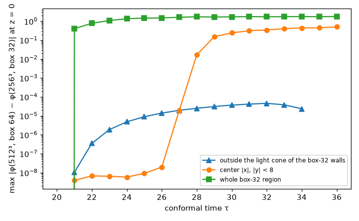

# 3 次元：交差するひもの衝突（512³、箱 64）

## 目的

`2026-10-23_crossing_strings_3d`（256³、箱 32）と同じ衝突を、箱を 64 に広げて（Δx = 0.125 は同じ）計算し、箱の壁（ディリクレ条件でひもの端を固定）の影響が組み換えに出ていないかを確かめる。

## 条件

- `src/bin/simulate3d.rs`: 512³、箱 64、Δx = 0.125、τ = 20 → 36。ひもの配置・速さは 256³ の計算と同じ（間隔 8、速さ 0.5）
- メモリを抑えるため Carpenter–Kennedy の 5 段 4 次 2N-storage RK（integrator=lsrk4、1 点 64 バイト）。256³ の計算は古典的 RK4。2 つの時間積分法の差は 2 次元の確認で 2e-6 程度
- 計算時間 約 65 分（8 コア）、最大メモリ 8.6GB

## 結果

- 組み換えの時刻は 256³（箱 32）と同じ（τ = 25〜26 の間）。
- z = 0 の断面で、両者の格子点が重なる領域の |φ_512 − φ_256| を比べた。箱 32 の壁の影響が光速で届いていない領域（|x|, |y| < 16 − (τ − 20) − 1）では、差は全時刻で 5e-5 以下だった。差が大きくなる（0.1〜1）のは、壁の影響が光速で届いた場所だけである。
- したがって、256³（箱 32）で見た組み換え（中心、τ ≈ 26）は壁の影響を受けていない。一方、組み換え後にひもがまっすぐ張っていく様子（τ ≳ 28 の中心から離れた部分）は、箱 32 では壁の固定の影響を受けている。

