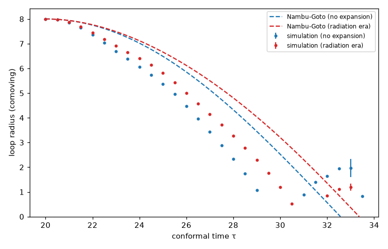

# 円形ループの収縮

## 目的

円形の大域的ひものループが自分の張力で縮んで消える様子を計算し、太さのない弦（南部・後藤の弦）の予言と比べる。

## 条件

- `src/bin/simulate3d.rs`（config=loop）: 256³、箱 32、Δx = 0.125、2N-storage RK（Δτ = 0.2Δx）、ディリクレ条件
- 初期条件: xy 平面に半径 R₀ = 8 の円形ループを静止させて置く。z 軸を含む断面では渦と反渦の組に見えるので、
  θ = atan2(z, ρ − R₀) − atan2(z, ρ + R₀)、振幅 f(d₁) f(d₂)（ρ = √(x² + y²)、d は (ρ, z) = (±R₀, 0) からの距離）
- 膨張なし（τ = 20 → 36）と輻射優勢期 a = τ/20（τ = 20 → 40）の 2 通り。λ = η = 1
- ループの半径: ひもの位置（巻き数をもつプラケットの中心）の z 軸からの距離の平均
- 南部・後藤の弦の円形ループ: R″ + 2ℋ(1 − R′²)R′ = −(1 − R′²)/R（膨張なしでは R = R₀ cos((τ − τ_i)/R₀)）

## 結果

- ループは南部・後藤の弦の予言より速く縮む。膨張なしでは τ_i からの経過 9.25（τ = 29〜29.5 の間）で潰れた。予言は πR₀/2 ≈ 12.6 なので約 25% 早い。輻射優勢期では経過 10.5〜11（予言 13.4）。
- 大域的ひもでは、ループの向かい側の部分同士（z 軸を含む断面で見ると渦と反渦）が長距離力で引き合うので、張力だけで縮む南部・後藤の弦より速く潰れると考えられる。
- 潰れた後、1〜2 時間単位の後に中心から小さなループが再び現れて半径 2 程度まで広がり、乱れて消える（膨張なし τ = 31〜33.5、輻射優勢期 τ = 32〜33）。再び現れたループは巻き数の向きが元と逆で、ひもが中心を通り抜けて反対側へ出てきたものにあたる。南部・後藤の弦の円形ループは R = R₀|cos((τ − τ_i)/R₀)| のように元の半径まで広がり直すが、場の理論では潰れる時に大部分のエネルギーが放射になるので、広がり直しは半径 2 程度で止まる。
- 半径が 1 程度まで小さくなるとコアの太さ（約 0.7）と同程度になり、太さのない弦の近似は使えない。

## 注意

- 格子は 1 種類だけで、解像度を変えた確認はしていない。
- ディリクレ条件の壁はループから 8 離れており、ループが収縮する間に壁で反射した放射が中心付近に戻ってくる可能性がある。
